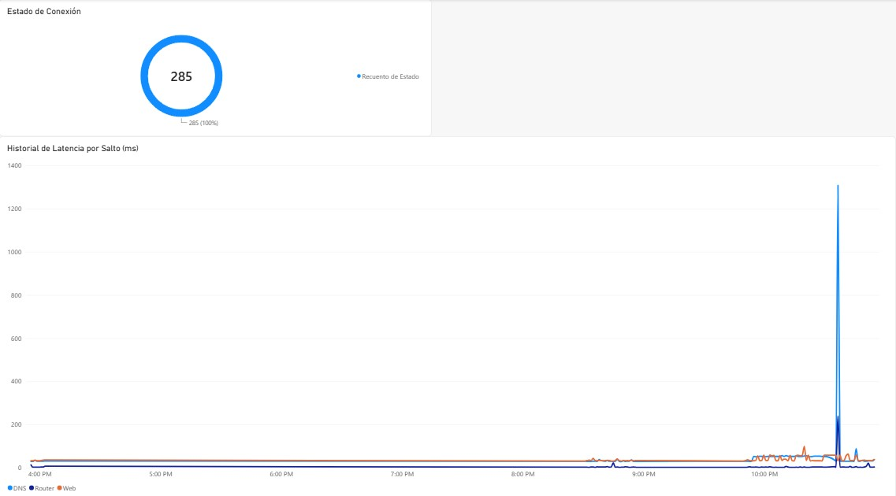

# Monitor de conectividad y diagnóstico de red local

Script en Python que mide la latencia y la disponibilidad de mi red cada 60 segundos,
guarda los resultados en SQLite y ayuda a identificar si una falla viene del router,
del proveedor de internet o de la latencia alta.

Proyecto personal para practicar Python, bases de datos y análisis de datos.

## El problema

A veces mi internet se pone lento o se corta y no sabía por qué. En lugar de adivinar,
construí una herramienta que registra datos para analizarlos.

## Cómo funciona

1. Hace ping a tres destinos: el router (`192.168.100.1`), un servidor DNS (`8.8.8.8`) y un sitio externo (`google.com`).
2. Guarda en SQLite el destino, la fecha y hora, la latencia en ms y si estuvo activo o caído.
3. Aplica reglas simples para clasificar la posible causa de cada falla.
4. Los datos se visualizan en Power BI (tiempo en línea y latencia).

| Si falla... | Posible causa |
|---|---|
| El router | Wi-Fi, señal o el propio router |
| Router bien, DNS externo caído | Proveedor de internet |
| DNS externo bien, el sitio falla | Problema de DNS |
| Latencia alta a ciertas horas | Posible saturación |

## Tecnologías

Python 3, SQLite, Power BI, Git. Librerías: `subprocess`, `re`, `sqlite3`, `csv`, `time`, `os`.

## Cómo ejecutarlo (Windows)

1. Instala Python.
2. Clona el repositorio:
   ```powershell
   git clone https://github.com/AngelME14/network-telemetry-monitor.git
   ```
3. Inicializa la base de datos:
   ```powershell
   python db_setup.py
   ```
4. Si tu router no usa `192.168.100.1`, cámbiala en `main.py`, en el diccionario `OBJETIVOS`.
5. Ejecuta:
   ```powershell
   python main.py
   ```
6. Los datos se guardan en `data/network_log.db` (y se exportan a CSV para Power BI con `python exportar_pbi.py`).

## Base de datos

Tabla `network_stats`: `id` (INTEGER), `timestamp` (DATETIME), `target_type` (TEXT), `target_address` (TEXT), `latency_ms` (REAL), `packet_loss_percent` (REAL), `status` (TEXT).

## Visualización



## Limitaciones y mejoras futuras

- Ping mide latencia y pérdida de paquetes, no el ancho de banda usado.
- Mejoras posibles: alertas por correo, medir velocidad real, correrlo como servicio, más destinos.

## Autor

José Ángel Morales Ezquivel, estudiante de Ingeniería en Administración de Sistemas (UANL-FIME)
